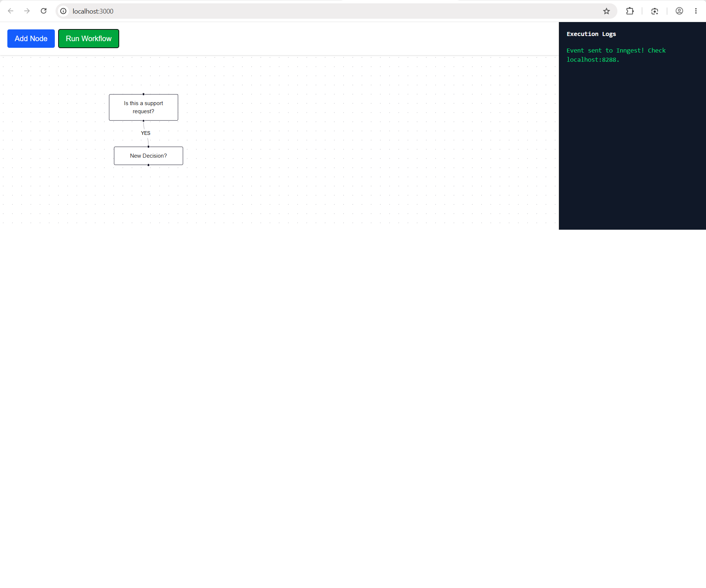
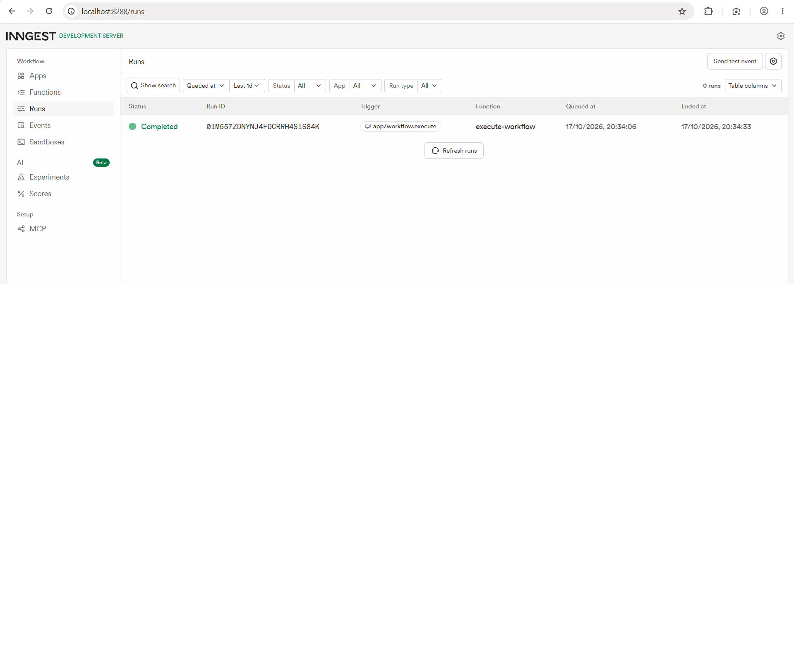

# AI Decision Flow

A visual workflow builder using React Flow and Inngest. Each node represents an AI prompt, and execution branches based on a YES/NO response from the LLM.

## Features
- **Visual Editor:** Add nodes, connect them, and double-click to edit the prompt.
- **YES/NO Branching:** Connect nodes using YES or NO edges.
- **Inngest Orchestration:** Execution runs step-by-step in the background.
- **Logs Panel:** View execution status.

## Setup
1. `npm install`
2. Create `.env.local` and add `OPENAI_API_KEY=your_openrouter_or_openai_key`
3. Run `npm run dev`
4. Run `npx inngest-cli@latest dev -u http://localhost:3000/api/inngest` in a second terminal
5. Open `http://localhost:3000` to build the flow. Watch it run at `http://localhost:8288`.

## Screenshots
### The Flow Editor

### Inngest Execution
